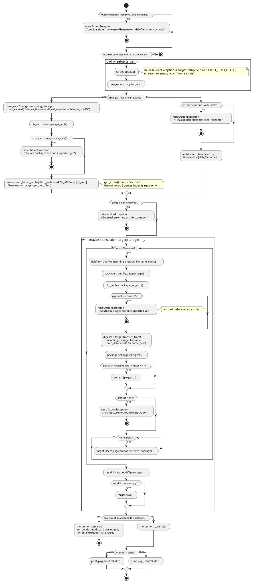

# ActionPkg.insert behavior

Explains how [`ActionPkg.insert`](../../src/debkit/action/action_pkg.py) moves one or more `.deb`
packages from the incoming storage into the target repository: either a `.changes` upload or a
single `.deb`, never both, inside one transaction so pool objects and rewritten indices commit
together. Rules are owned by [STYLE.md](../../STYLE.md#layers) (action layer),
[CONFIG.md](../../CONFIG.md#insert) (flags),
[VALIDATION.md](../../VALIDATION.md#debian-source-strings) (deb source and file rules),
[VALIDATION.md](../../VALIDATION.md#filename-safety) (upload names),
[CRYPTO.md](../../CRYPTO.md#verification-failures) (`.changes` and payload digests),
[EXCEPTIONS.md](../../EXCEPTIONS.md#cli-exit-groups) (exit groups), and
[STORAGE.md](../../STORAGE.md#transactions) (transaction behavior). The user-facing walkthrough is
in [examples.md](../guides/examples.md#add-packages-from-a-changes-upload).

## Activity diagram

## Sequence diagram

## Details that matter

- Only a target with neither `Release` nor `InRelease` is set up as a new repository; any other
  read failure stops the run, so an existing repository is never set up again →
  [EXCEPTIONS.md](../../EXCEPTIONS.md#orchestration-vs-repo-semantics).
- `maybe_transaction` holds `history_lock` for the whole body, bulk transfers included, so a
  concurrent writer on the same root waits and — on S3 — fails after the 300 s acquire timeout →
  [txstore STORAGE.md](https://github.com/vinklat/txstore/blob/v0.1.1/STORAGE.md#locking). A
  malformed `.transactions.json` aborts the run before `transaction_begin` →
  [STORAGE.md](../../STORAGE.md#transactions).
- An unsafe `.changes` entry, `Package` or `Source` name, or pool path is refused before any
  transfer → [VALIDATION.md](../../VALIDATION.md#filename-safety). A `.deb` whose transferred
  digests differ from its `.changes` entry is refused after it →
  [CRYPTO.md](../../CRYPTO.md#verification-failures).
- `transfer_from` is the only path that writes package content; index files (`Packages`, `Release`,
  and its signatures) are emitted by `target.save()` only when the diff is non-empty →
  [CRYPTO.md](../../CRYPTO.md#gpg).
- Any in-loop failure (corrupt `.deb`, transport error, digest mismatch) discards every staged
  footmark and leaves the live repository untouched → [STORAGE.md](../../STORAGE.md#transactions).
- A non-transactional target skips begin, commit, and discard entirely; the same link explains why
  `FootmarkMixin` is the discriminator.
- Escaped `ActionException`, `ValueError`, and `StorageException` reach the CLI as the Generic
  group, a refused `.deb` (`DebFileException`) as Read, a refused `.changes` (`ChangesException`) as
  Write, and a digest mismatch as Distrustful →
  [EXCEPTIONS.md](../../EXCEPTIONS.md#cli-exit-groups).

## Testing notes

`tests/test_action_pkg.py` covers argument combinations, error propagation, and the transaction
wiring (begin/commit on success, discard on failure, no-op on a non-transactional storage);
`tests/test_repo_rw.py` covers the index mutations; `tests/test_debfile.py` and
`tests/test_changes.py` cover the upload-name refusals →
[TESTING.md](../../TESTING.md#required-coverage).

## Related contracts

- [STYLE.md](../../STYLE.md#layers), [CONFIG.md](../../CONFIG.md#insert),
  [VALIDATION.md](../../VALIDATION.md#debian-source-strings),
  [VALIDATION.md](../../VALIDATION.md#filename-safety),
  [CRYPTO.md](../../CRYPTO.md#verification-failures),
  [EXCEPTIONS.md](../../EXCEPTIONS.md#cli-exit-groups), [STORAGE.md](../../STORAGE.md#transactions).
- Sibling pages: [action_pkg_remove.md](action_pkg_remove.md), [action_sync.md](action_sync.md),
  [repo_sync_indices.md](repo_sync_indices.md),
  [txstore class map](https://github.com/vinklat/txstore/blob/v0.1.1/docs/development/class.md).
