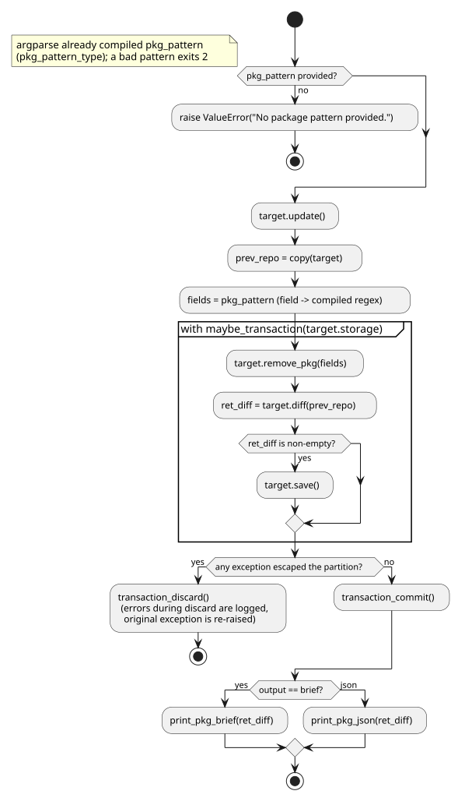

# ActionPkg.remove behavior

Explains how [`ActionPkg.remove`](../../src/debkit/action/action_pkg.py) removes the packages whose
fields match a JSON regex map such as `{"Package": "hello", "Version": "1.0"}`: the parsed pattern
is applied in memory by `RepoRW.remove_pkg`, and the payload deletes and index rewrite run inside
one transaction. Rules are owned by [STYLE.md](../../STYLE.md#layers) (action layer),
[CONFIG.md](../../CONFIG.md#remove) (flags),
[VALIDATION.md](../../VALIDATION.md#package-pattern-matching) (pattern rules),
[EXCEPTIONS.md](../../EXCEPTIONS.md#orchestration-vs-repo-semantics) (no-match semantics), and
[STORAGE.md](../../STORAGE.md#transactions) (transaction behavior). The user-facing walkthrough is
in [examples.md](../guides/examples.md#remove-packages).

## Activity diagram

## Sequence diagram

## Details that matter

- `maybe_transaction` holds `history_lock` for the whole body, bulk transfers included, so a
  concurrent writer on the same root waits and — on S3 — fails after the 300 s acquire timeout →
  [txstore STORAGE.md](https://github.com/vinklat/txstore/blob/v0.1.1/STORAGE.md#locking). A
  malformed `.transactions.json` aborts the run before `transaction_begin` →
  [STORAGE.md](../../STORAGE.md#transactions).
- The argument parser turns `--pkg-pattern` into compiled regexes, so a malformed pattern exits 2
  before the target is read →
  [VALIDATION.md](../../VALIDATION.md#package-pattern-matching).
- `Packages.remove` only drops matching entries from its in-memory index and returns their
  filenames; `RepoRW.remove_pkg` deletes each payload once, since an `Architecture: all` package is
  listed by every binary arch index. The rewritten indices reach storage only through
  `target.save()`, and only when the diff is non-empty.
- No match is an orchestration failure, not a write failure →
  [EXCEPTIONS.md](../../EXCEPTIONS.md#orchestration-vs-repo-semantics).
- A non-transactional target skips begin, commit, and discard →
  [STORAGE.md](../../STORAGE.md#transactions); `remove` is rarely useful there because such backends
  cannot persist the rewritten indices.

## Testing notes

`tests/test_argtypes.py` covers pattern parsing, length, and compilation; `tests/test_action_pkg.py`
covers the no-match `ActionException` and the transaction wiring; `tests/test_packages.py` covers
`Packages.remove()` and its filename-safety check; `tests/test_repo_rw.py` removes an `all` payload
from a real `StorageFS` → [TESTING.md](../../TESTING.md#required-coverage).

## Related contracts

- [STYLE.md](../../STYLE.md#layers), [CONFIG.md](../../CONFIG.md#remove),
  [VALIDATION.md](../../VALIDATION.md#package-pattern-matching),
  [EXCEPTIONS.md](../../EXCEPTIONS.md#orchestration-vs-repo-semantics),
  [STORAGE.md](../../STORAGE.md#transactions).
- Sibling pages: [action_pkg_insert.md](action_pkg_insert.md), [action_sync.md](action_sync.md),
  [repo_sync_indices.md](repo_sync_indices.md),
  [txstore class map](https://github.com/vinklat/txstore/blob/v0.1.1/docs/development/class.md).
