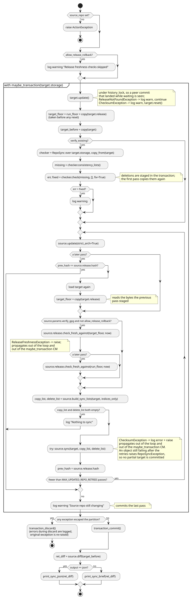
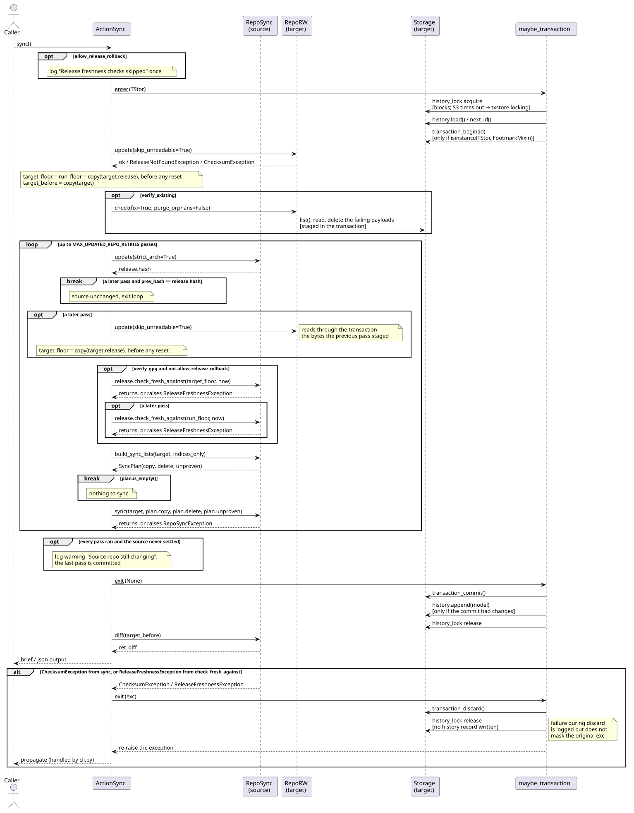

# ActionSync.sync behavior

Explains how [`ActionSync.sync`](../../src/debkit/action/action_sync.py) mirrors a Debian repository
from a `RepoSync` source into a `RepoRW` target inside one transaction, so a transaction-capable
target commits every change or discards them all. Rules are owned by
[STYLE.md](../../STYLE.md#layers) (action layer), [CONFIG.md](../../CONFIG.md#sync) (flags),
[CRYPTO.md](../../CRYPTO.md#release-freshness) (source Release freshness),
[CRYPTO.md](../../CRYPTO.md#verification-failures) (checksum abort),
[EXCEPTIONS.md](../../EXCEPTIONS.md#cli-exit-groups) (exit groups), and
[STORAGE.md](../../STORAGE.md#transactions) (transaction behavior). The user-facing walkthrough is
in [examples.md](../guides/examples.md#mirror-a-repository).

## Activity diagram

## Sequence diagram

## Details that matter

- `maybe_transaction` holds `history_lock` for the whole body, bulk transfers included, so a
  concurrent writer on the same root waits and — on S3 — fails after the 300 s acquire timeout →
  [txstore STORAGE.md](https://github.com/vinklat/txstore/blob/v0.1.1/STORAGE.md#locking). A
  malformed `.transactions.json` aborts the run before `transaction_begin` →
  [STORAGE.md](../../STORAGE.md#transactions).
- The target is loaded inside that body, so a peer that commits while this run waits for the lock is
  what every pass plans, floors, and reports against; `--verify-existing` reads it once more before
  the lock for its own check only.
- The source repository is re-read after each pass until its `Release` hash is stable, so a source
  that changes during the mirror is synced again rather than left inconsistent.
- With GPG verification on, each pass checks the source Release against the loaded target Release
  before building its lists, so an expired or older source fails the run instead of purging newer
  target objects. A later pass also checks against the target as the run found it, so a staged
  target reset as corrupt cannot lower the floor; a failure there discards what earlier passes
  staged. `--allow-release-rollback` skips the check and warns once →
  [CRYPTO.md](../../CRYPTO.md#release-freshness).
- A `ChecksumException` from `RepoSync.sync` aborts the whole retry loop; the mismatching target
  object is deleted and every staged footmark is discarded, so no partial commit is produced →
  [CRYPTO.md](../../CRYPTO.md#verification-failures).
- Corrupted target indices are logged, the target is reset, and the sync proceeds, copying every
  selected index again; `--verify-existing` re-checks and fixes existing packages first.
- A target with neither `Release` nor `InRelease` is synced as empty; any other read failure stops
  the run → [EXCEPTIONS.md](../../EXCEPTIONS.md#orchestration-vs-repo-semantics).
- A later pass reloads the target inside the transaction, so it plans against what the previous pass
  staged. The printed package counts compare against a copy of the target taken before the first
  pass.
- A non-transactional target skips begin, commit, and discard; atomicity on a failing backend is
  best-effort → [STORAGE.md](../../STORAGE.md#transactions).
- Which index files `build_sync_lists` copies is decided from the root Release digest block →
  [repo_sync_indices.md](repo_sync_indices.md).
- Exit groups: `RepoSyncException` is Sync; a digest mismatch and a refused source Release are
  Distrustful → [EXCEPTIONS.md](../../EXCEPTIONS.md#cli-exit-groups).

## Testing notes

`tests/test_action_sync.py` covers the retry loop, checksum abort, the per-pass freshness check and
its skips, transaction wiring, and `--verify-existing`; `tests/test_release.py` covers each
freshness rule; `tests/test_repo_sync.py` covers list building and transfer →
[TESTING.md](../../TESTING.md#required-coverage).

## Related contracts

- [STYLE.md](../../STYLE.md#layers), [CONFIG.md](../../CONFIG.md#sync),
  [CRYPTO.md](../../CRYPTO.md#release-freshness),
  [CRYPTO.md](../../CRYPTO.md#verification-failures),
  [EXCEPTIONS.md](../../EXCEPTIONS.md#cli-exit-groups), [STORAGE.md](../../STORAGE.md#transactions).
- Sibling pages: [repo_sync_indices.md](repo_sync_indices.md),
  [action_pkg_insert.md](action_pkg_insert.md), [action_pkg_remove.md](action_pkg_remove.md),
  [txstore class map](https://github.com/vinklat/txstore/blob/v0.1.1/docs/development/class.md).
