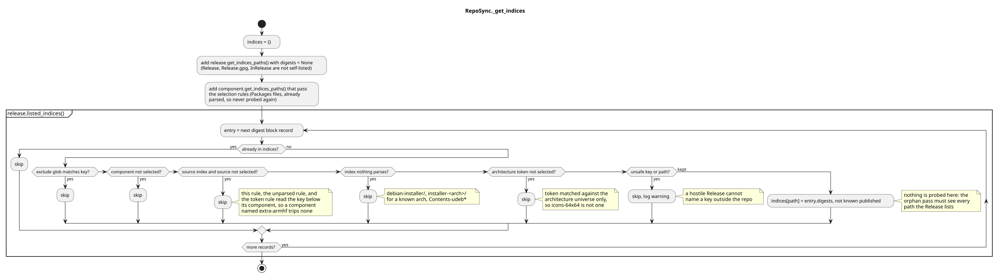
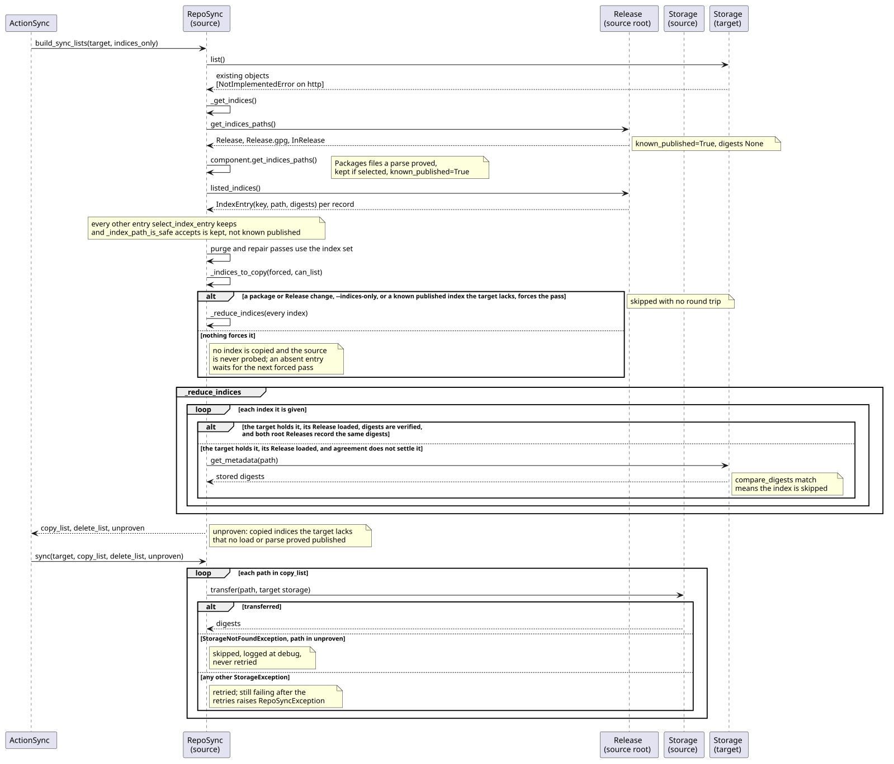

# RepoSync index selection

Explains how [`RepoSync`](../../src/debkit/repo/repo_sync.py) decides which index files a mirror
copies, and why that set is now read from the signed root `Release` instead of rebuilt by name.
Rules are owned by [CONFIG.md](../../CONFIG.md#sync) (flags),
[VALIDATION.md](../../VALIDATION.md#repository-index-paths) (index paths),
[VALIDATION.md](../../VALIDATION.md#index-selection) (selection, probe, and skip rules),
[VALIDATION.md](../../VALIDATION.md#index-exclude-globs) (exclude globs),
[CRYPTO.md](../../CRYPTO.md#verification-order) (checksum sources), and
[txstore STORAGE.md](https://github.com/vinklat/txstore/blob/v0.1.1/STORAGE.md#storage-abi)
(`exists` and `get_metadata`). The surrounding subcommand flow is in
[action_sync.md](action_sync.md); the user-facing walkthrough is in
[examples.md](../guides/examples.md#mirror-a-repository).

## Code map

| Concern | Module | Notes |
| -- | -- | -- |
| Layout prefix | `repo/params.py` | `RepoParams.indices_path()` maps a Release-relative key to a storage path |
| Layout inverse | `repo/params.py` | `RepoParams.release_key()` maps a storage path back to its Release key |
| Path safety | txstore | `is_unsafe_path()` rejects an unsafe index key → [VALIDATION.md](../../VALIDATION.md#filename-safety) |
| Source payloads | `repo/sources.py` | `Sources` expands each stanza so payload files join the package set, unless a Release lists them |
| Manifest | `repo/release.py` | `IndexEntry`, `Release.listed_indices()` over the digest block |
| Selection | `repo/repo_sync.py` | `select_index_entry()` applies exclude, component, source, unparsed-index, and architecture rules; the last three read the key below its component |
| Index set | `repo/repo_sync.py` | `RepoSync._get_indices()` builds path → `IndexTarget` (expected digests, and whether a parse proved the path) |
| Copy reduction | `repo/repo_sync.py` | `RepoSync._reduce_indices()` drops indices the target already holds and probes what is left |
| Flag wiring | `action/action_sync.py` | `--architectures` and `--indices-exclude` reach both repo params |

## Activity diagram

Three hand-written discoverers used to decide the set, each looking for one filename shape. Any
other index the Release listed was neither copied nor recognized, so `build_sync_lists` deleted it
from the target as an orphan and apt got a 404 for it.

Now the digest block of the root Release is the manifest. Every path it lists is a candidate,
filtered by selection rules and by what the source actually publishes.

## Sequence diagram

## Details that matter

- Existence is probed at transfer, not at discovery. A Release lists paths the repository never
  publishes, so a path handed to the transfer unprobed would fail it and, after the retries, raise
  `RepoSyncException` (Sync), aborting the whole mirror →
  [EXCEPTIONS.md](../../EXCEPTIONS.md#cli-exit-groups). The probe is one `exists()` per entry:
  `list()` takes no prefix, so resolving the same question from a listing would enumerate the whole
  pool. Probing every listed entry while building the set cost that round trip on every run, against
  a source that is usually HTTP and answers each with a fresh connection; `_reduce_indices` pays it
  only for an entry it is about to copy and the target lacks, so a point release that changes
  hundreds of held indices pays none: an earlier transfer proved the source publishes them, so a
  changed digest is a republish. Indices discovered while parsing are already known to exist and are
  never probed.
- Agreeing Release blocks settle only an entry the target holds, and save it the metadata round
  trip. They do not settle an absent one: the last sync copies the Release whether or not it copied
  the object, so a source that 404s once records the digest anyway and agreement would keep skipping
  the probe until that digest changed → [VALIDATION.md](../../VALIDATION.md#index-selection). The
  price is one `exists()` per absent key on every run, which the uncompressed variants an archive
  lists and never ships pay in full, dozens per Release. A later pass of the same sync compares
  against the Release the previous pass staged, because `ActionSync` reloads the target through the
  transaction before it.
- A target reset after a checksum failure settles nothing: its stored metadata was written with the
  bytes the failed check distrusts, so every index it holds is copied again →
  [VALIDATION.md](../../VALIDATION.md#index-selection).
- A listed path stays in the set whether or not the source publishes it, so the orphan pass cannot
  delete a target object the source Release truthfully lists. Its absence from the target is
  expected and does not force the index pass; only a path a parse proved can do that. With nothing
  else to sync those absent entries are still reduced on their own, which recovers one the source
  404ed once; that pass copies no root Release file, so a run recovering nothing writes nothing →
  [VALIDATION.md](../../VALIDATION.md#index-selection).
- The root `Release`, `Release.gpg`, and `InRelease` files are not listed in their own digest block,
  so they map to no digests and always copy when the index pass runs →
  [VALIDATION.md](../../VALIDATION.md#repository-index-paths). Each copy must match the bytes the
  root Release load fetched and verified, so a source cannot pass the checks with one Release and
  serve another → [CRYPTO.md](../../CRYPTO.md#verification-order).
- An architecture token is matched only against the architectures the repository knows: the selected
  set plus the root Release tokens, from `Repo.release_archs()`. A name part that merely looks like
  one, such as `dep11/icons-64x64.tar.gz`, is left alone, and `all` is always selected. Where
  several known architectures end at one token the longest owns it, so selecting `kfreebsd-amd64`
  keeps its indices even while plain `amd64` is unselected →
  [VALIDATION.md](../../VALIDATION.md#index-selection).
- Source indices follow the `source` architecture: `<component>/source/` keys, flat `Sources*`
  files, and `-source` tokens are mirrored only when it is selected, so a mirror never carries a
  `Sources` index whose payloads it lacks. An existing target purges them when the selection drops →
  [VALIDATION.md](../../VALIDATION.md#index-selection).
- `debian-installer` indices are never mirrored, for the same reason. `Packages` opens only
  `<component>/binary-<arch>/Packages*` and `<component>/source/Sources*`, so a d-i stanza is never
  parsed and its `.udeb` payloads never join the package set: mirroring the index would leave apt
  reading one whose objects 404. An existing target purges the index together with those payloads on
  the first sync after the rule lands → [VALIDATION.md](../../VALIDATION.md#index-selection).
- Two more shapes carry that content from outside the directory, so each is matched on its own.
  `installer-<arch>/` image trees are a directory segment naming an architecture the repository
  knows: the Release lists their `MD5SUMS` and `SHA256SUMS` manifests, not the netboot images beside
  them, so mirroring one copies a checksum file for a tree the mirror does not hold.
  `Contents-udeb-<arch>` is a file name at the component or dists root, listing paths to the same
  udebs. Both name a selected architecture, so only this rule drops them →
  [VALIDATION.md](../../VALIDATION.md#index-selection).
- The component segment is a name the repository chose, so the source, unparsed, and architecture
  token rules read only the path below it. Before, a component such as `extra-armhf` lost every
  index under it whenever `armhf` was known but unselected, and the orphan pass then purged them
  from the target → [VALIDATION.md](../../VALIDATION.md#index-selection).
- A parsed stanza cannot put a dropped index back. A `Filename` a Release digest block also lists is
  an index whatever names it, so it leaves the package set and the rules above settle it alone:
  otherwise a d-i stanza naming its own `Packages.gz` would copy that index as an ordinary payload,
  and the orphan pass would spare it for being a package. A Release never lists a pool object, so no
  real payload is dropped → [VALIDATION.md](../../VALIDATION.md#index-selection).
- `by-hash/` objects are not mirrored because the Release does not list them. apt falls back to the
  canonical index path after a 404 → [ROADMAP.md](../../ROADMAP.md#known-deviations).
- Index checksums need no new verification path: `Repo.verify_checksum` maps the path back through
  `RepoParams.release_key()`, and a Release digest block decides a listed key →
  [CRYPTO.md](../../CRYPTO.md#verification-order).
- Excluding an index with `--indices-exclude` also purges it from the target, because an object
  outside the index set and outside the package set is an orphan. The globs reach every candidate,
  including the `Packages` files found while parsing, so a glob wide enough to match one produces a
  target apt cannot use → [VALIDATION.md](../../VALIDATION.md#index-exclude-globs).
- A Release-listed key that `is_unsafe_path()` rejects is dropped with a warning rather than
  raising, so one malformed or hostile record cannot stop a mirror →
  [VALIDATION.md](../../VALIDATION.md#filename-safety).

## Testing notes

`tests/test_release.py` covers `listed_indices` across the three layouts; `tests/test_params.py`
covers the `indices_path` / `release_key` round trip; `tests/test_storage_url.py` covers
`is_unsafe_path`; `tests/test_sources.py` covers the `Sources` expansion; `tests/test_repo_sync.py`
covers `select_index_entry`, the index set, skip, purge, source-probing, and flat-layout behavior in
`build_sync_lists`; `tests/test_argparser.py` and `tests/test_action_sync.py` cover the flag and its
hand-off to both repo params → [TESTING.md](../../TESTING.md#required-coverage).

## Related contracts

- [CONFIG.md](../../CONFIG.md#sync), [VALIDATION.md](../../VALIDATION.md#repository-index-paths),
  [VALIDATION.md](../../VALIDATION.md#index-selection),
  [VALIDATION.md](../../VALIDATION.md#index-exclude-globs),
  [CRYPTO.md](../../CRYPTO.md#verification-order),
  [txstore STORAGE.md](https://github.com/vinklat/txstore/blob/v0.1.1/STORAGE.md#storage-abi).
- Sibling pages: [action_sync.md](action_sync.md), [action_pkg_insert.md](action_pkg_insert.md),
  [action_pkg_remove.md](action_pkg_remove.md),
  [txstore class map](https://github.com/vinklat/txstore/blob/v0.1.1/docs/development/class.md).
